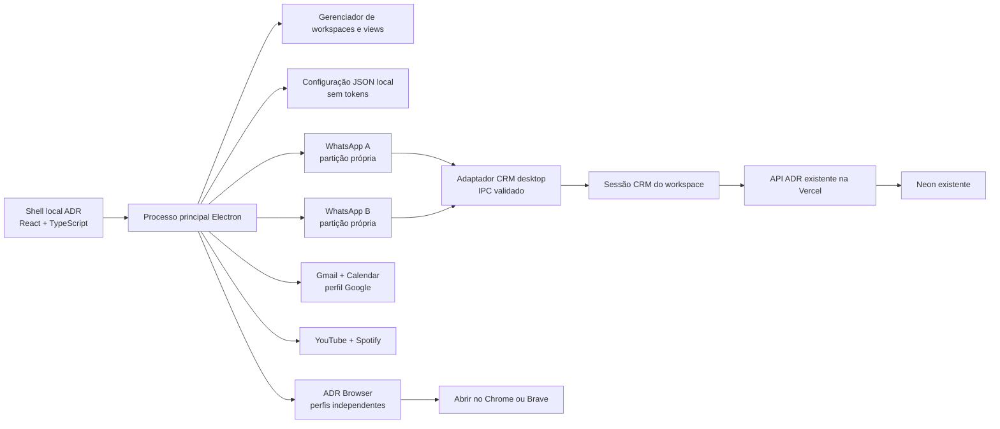

# Plano mestre — ADR Workspace para Ubuntu

> Documento executável por uma equipe humana ou por qualquer IA de programação.
>
> Status: arquitetura revisada após auditoria da extensão ADR CRM 0.12.5.
>
> Data de referência: 22 de julho de 2026.

## 1. Resumo executivo

O projeto é viável, com uma ressalva importante: não devemos tentar reproduzir integralmente o Chrome, o Brave ou o sistema genérico de extensões dentro do Electron.

A solução recomendada é:

- Aplicativo desktop em Electron/Chromium para Ubuntu.
- Interface única, minimalista e personalizada com a marca ADR.
- Quantidade ilimitada de instâncias cadastradas de WhatsApp, limitada apenas pela memória e pelo processador da máquina.
- Uma sessão Chromium isolada para cada WhatsApp.
- Integração nativa do ADR CRM, reutilizando o código da extensão 0.12.5.
- Gmail, Calendar, YouTube, Spotify e sites gerais como serviços internos.
- Navegador interno baseado no Chromium do Electron.
- Botões para abrir a página atual no Chrome ou Brave instalado no Ubuntu.
- Nenhuma nova assinatura paga.
- GitHub, Vercel e Neon existentes permanecem como infraestrutura.
- CastLabs gratuito para tentar habilitar Spotify/Widevine.
- `.deb` como pacote principal e AppImage como alternativa.

### Veredito de viabilidade

| Requisito | Viabilidade | Decisão |
|---|---:|---|
| Vários WhatsApps isolados | Alta | Implementar nativamente |
| Todas as funções da extensão ADR 0.12.5 | Alta | Converter para integração nativa |
| Carregar qualquer extensão Chrome | Baixa | Fora do escopo |
| Gmail e Calendar embutidos | Média/alta | Validar login Google em spike |
| YouTube embutido | Alta | Implementar |
| Spotify embutido | Média | CastLabs gratuito + fallback externo |
| Navegação geral embutida | Alta | ADR Browser baseado em Chromium |
| Chrome/Brave literalmente embutidos | Muito baixa | Abrir externamente |
| Custo recorrente adicional zero | Alta | Regra obrigatória de arquitetura |

Não é loucura construir o ADR Workspace. Seria loucura tentar manter um fork completo do Chromium ou prometer compatibilidade irrestrita com a Chrome Web Store.

---

## 2. Evidências obtidas

### Auditoria da extensão ADR

Arquivo analisado:

`/home/bira/Documentos/CRM/adr-crm-chrome-extension-0.12.5.zip`

- Versão: `0.12.5`.
- Manifest: Chrome Manifest V3.
- SHA-256: `d367acdf96901ac2c46f7911ed6e9e4467d5e7b6d3d6a721db8283a102ea24b8`.
- Tamanho: 44.757 bytes.
- Permissões: `storage`, `cookies` e `scripting`.
- Hosts: WhatsApp Web, ADR CRM e localhost.
- APIs Chrome usadas:
  - `chrome.cookies`;
  - `chrome.runtime`;
  - `chrome.scripting.executeScript`;
  - `chrome.storage.local`;
  - `chrome.storage.managed`;
  - `chrome.storage.session`.

Funcionalidades identificadas:

- Autenticação no ADR CRM.
- Identificação do usuário.
- Identificação do contato/conversa aberta no WhatsApp.
- Consulta do contato no CRM.
- Tradução.
- Transcrição de áudio.
- Respostas rápidas.
- Cache de transcrições.
- Suporte a impersonação autorizada.
- Configuração de `baseUrl` e tenant.
- Painel e controles inseridos no WhatsApp Web.

A extensão é pequena, está razoavelmente separada entre DOM, UI e background, e pertence à ADR. Portanto, converter seu adaptador Chrome em um adaptador desktop é tecnicamente mais seguro do que tentar emular o Chrome inteiro.

### Problema descoberto no canal atual da extensão

O [`update_manifest.xml`](https://app.adragencia.com.br/extension-updates/update_manifest.xml) atualmente anuncia a versão `0.12.2`, enquanto o ZIP entregue é `0.12.5`.

Isso significa que novas instalações ou atualizações pelo canal hospedado podem receber uma versão antiga. O plano inclui corrigir esse processo antes de manter Chrome e desktop a partir do mesmo código.

### Por que não carregar diretamente o ZIP no Electron

O próprio Electron informa que suporta apenas um subconjunto das APIs de extensões e não promete compatibilidade com extensões arbitrárias da Chrome Web Store. Recursos MV3 usados pelo ADR CRM não funcionariam integralmente sem adaptação. Consulte a [documentação oficial do Electron](https://www.electronjs.org/docs/latest/api/extensions/).

A biblioteca `electron-chrome-extensions` foi descartada porque sua forma de licenciamento cria obrigação GPL ou licença comercial recorrente, contrariando a restrição de custo e complicando a propriedade do produto. Consulte o [pacote e sua licença](https://www.npmjs.com/package/electron-chrome-extensions).

Também não será usado `--load-extension` no Chrome oficial: builds recentes removeram esse suporte de linha de comando, e a distribuição externa no Linux exige políticas gerenciadas ou empacotamento apropriado. Consulte a [discussão oficial do Chromium](https://groups.google.com/a/chromium.org/g/chromium-extensions/c/1-g8EFx2BBY) e a [documentação de distribuição](https://developer.chrome.com/docs/extensions/how-to/distribute/install-extensions).

---

## 3. Benchmark e posicionamento

| Produto | Ponto forte | Limitação para a ADR | Custo/decisão |
|---|---|---|---|
| [Rambox](https://rambox.app/pricing/) | Workspaces, múltiplas sessões e integrações | Recursos avançados e extensões dependem de produto fechado | Assinatura rejeitada |
| [Franz](https://meetfranz.com/pricing) | Serviços de mensagens em uma interface | Não resolve de forma confiável a extensão MV3 ADR | Assinatura rejeitada |
| [Ferdium](https://ferdium.org/) | Código aberto e múltiplos serviços | Continua sendo wrapper de serviços; extensão ADR exigiria adaptação | Boa referência de UX |
| [Wavebox](https://wavebox.io/pricing) | Mais próximo de um navegador Chromium completo | Produto fechado e pago | Melhor referência funcional |
| [Shift](https://shift.com/pricing) | Organização de contas e produtividade | Alto custo e suporte Linux limitado ou ausente em alguns planos | Rejeitado |
| ADR Workspace | CRM próprio, custo zero incremental e controle total | Exige manutenção contínua do WhatsApp DOM e Electron | Solução escolhida |

### Conclusão do benchmark

Wavebox é o concorrente mais próximo da ideia de “navegador de produtividade”. Ferdium é a melhor referência de estrutura aberta. Entretanto, nenhum deles oferece simultaneamente:

- Integração garantida com o ADR CRM.
- Controle total do produto.
- Custo recorrente adicional zero.
- Personalização completa ADR.
- Estratégia própria de isolamento por workspace.

---

## 4. Escopo fechado da versão 1

### Incluído

- Ubuntu 24.04 e 26.04 LTS x64.
- Funcionamento em Wayland e X11.
- Múltiplos workspaces.
- Múltiplos WhatsApps independentes.
- CRM ADR nativo com paridade integral à extensão 0.12.5.
- Gmail e Calendar.
- YouTube.
- Spotify, condicionado ao teste Widevine.
- Navegador geral com abas e perfis.
- Downloads, uploads e permissões.
- Histórico e favoritos locais.
- Notificações, badges e bandeja do sistema.
- Suspensão de serviços inativos.
- Recuperação depois de falha ou reinicialização.
- Tema claro, escuro e automático.
- `.deb`, AppImage e GitHub Releases.
- Logs locais redigidos e exportáveis.
- Canal beta e canal estável.

### Fora da versão 1

- Compatibilidade com extensões Chrome arbitrárias.
- Chrome Web Store embutida.
- Chrome Sync.
- Gerenciador de senhas equivalente ao Chrome.
- Brave Shields ou recursos próprios do Brave.
- Fork do Chromium.
- Windows, macOS e mobile.
- Sincronização em nuvem das configurações do aplicativo.
- Novo backend.
- Acesso direto do desktop ao Neon.
- Disparos em massa ou automações não existentes na extensão.
- Telemetria paga ou envio automático de dados.
- Atualização silenciosa de pacote `.deb` com privilégios de root.

---

## 5. Critérios de sucesso

A versão 1 será aprovada somente se:

1. Duas ou mais contas de WhatsApp permanecerem autenticadas e isoladas depois de reiniciar o aplicativo.
2. A sessão de um workspace não puder ler cookies ou dados de outro.
3. Todas as funcionalidades identificadas na extensão 0.12.5 passarem no teste de paridade.
4. Nenhum token do CRM chegar ao JavaScript da página do WhatsApp.
5. Gmail, Calendar e YouTube funcionarem no pacote instalado, não apenas em desenvolvimento.
6. Spotify reproduzir áudio no `.deb` ou entrar automaticamente em modo externo claramente identificado.
7. O navegador permitir navegação, abas, downloads, uploads, perfis e abertura externa.
8. O aplicativo não exigir nenhuma nova assinatura paga.
9. O `.deb` instalar e iniciar em uma VM limpa do Ubuntu 24.04 e 26.04.
10. Smoke tests, testes visuais, segurança e soak test forem aprovados.
11. O aplicativo cadastrar pelo menos 20 instâncias e administrar quantas ficam carregadas conforme a RAM.
12. Não houver regressão visual não aprovada.
13. Atualização beta para estável e recuperação de estado forem testadas.

---

## 6. Arquitetura definida



### Stack

- Electron com o build gratuito Electron for Content Security da CastLabs.
- `BaseWindow` e `WebContentsView`.
- Não usar `BrowserView`, que está obsoleto.
- Não usar `<webview>`, desaconselhado pelo Electron.
- TypeScript em modo `strict`.
- React e Vite para a interface local.
- Tailwind CSS e componentes Radix/shadcn copiados para o projeto.
- Zod para validação de estado e IPC.
- pnpm workspaces.
- Vitest para testes unitários.
- Playwright para E2E, smoke e screenshots.
- electron-builder para `.deb` e AppImage.
- electron-updater apenas para AppImage.
- ESLint e Prettier.
- `electron-log` com redação adicional de informações sensíveis.

A versão exata do Electron/CastLabs será escolhida mecanicamente no início do desenvolvimento:

1. Selecionar o release estável mais recente do CastLabs ECS.
2. Confirmar a versão Electron correspondente na matriz oficial.
3. Não usar release beta, nightly ou `latest`.
4. Fixar a versão exata no lockfile.
5. Registrar a combinação em uma ADR técnica.
6. Atualizar apenas por PR específico com toda a matriz de testes.

### Estrutura do código

```text
apps/desktop
packages/contracts
packages/crm-core
packages/crm-whatsapp-ui
packages/crm-chrome-adapter
packages/crm-desktop-adapter
packages/service-adapters
tests/e2e
tests/visual
docs
```

- `crm-core`: operações, modelos, validação e regras puras.
- `crm-whatsapp-ui`: DOM, painel, CSS e controles compartilhados.
- `crm-chrome-adapter`: background/service worker e APIs Chrome.
- `crm-desktop-adapter`: preload isolado, IPC e acesso à sessão Electron.
- `contracts`: tipos compartilhados sem dependência do Electron.
- `service-adapters`: WhatsApp, Google, YouTube, Spotify e navegador.

### Modelo de dados público

```ts
type ServiceKind =
  | "whatsapp"
  | "gmail"
  | "calendar"
  | "youtube"
  | "spotify"
  | "browser";

interface Workspace {
  id: string;
  name: string;
  color: string;
  icon?: string;
  crmProfileId: string;
  serviceInstanceIds: string[];
  createdAt: string;
  updatedAt: string;
  deletedAt?: string;
}

interface ServiceInstance {
  id: string;
  workspaceId: string;
  kind: ServiceKind;
  name: string;
  startUrl: string;
  profileId: string;
  pinned: boolean;
  keepAwake: boolean;
  deletedAt?: string;
}

interface Profile {
  id: string;
  kind: "whatsapp" | "google" | "browser" | "crm";
  name: string;
  partitionName: string;
  createdAt: string;
}

interface AppStateV1 {
  schemaVersion: 1;
  workspaces: Workspace[];
  services: ServiceInstance[];
  profiles: Profile[];
  activeWorkspaceId?: string;
  activeServiceId?: string;
  settings: AppSettings;
}
```

Regras:

- Cada WhatsApp recebe um perfil e uma partição próprios.
- Gmail e Calendar compartilham o perfil Google do workspace por padrão.
- O usuário pode criar perfis Google separados.
- Cada workspace recebe uma sessão CRM própria.
- Perfis do navegador podem ser reutilizados por várias abas.
- O nome da partição é criado no processo principal e nunca aceito do renderer.
- Tokens, cookies e senhas não entram no `AppStateV1`.

### Persistência

- Estado em `app.getPath("userData")/state.v1.json`.
- Arquivo com permissão Linux `0600`.
- Escrita atômica: arquivo temporário, `fsync` e renomeação.
- Backup do último estado válido.
- Migrações incrementais por `schemaVersion`.
- Cookies e local storage permanecem nas partições Chromium.
- Exclusão de workspace será reversível por 30 dias.
- Ao excluir, fechar views, descarregar a sessão e mover os dados para uma área local de recuperação.
- Nenhum dado de sessão será excluído por glob ou caminho fornecido pelo renderer.

---

## 7. Integração nativa do ADR CRM

### Operações suportadas

```ts
type CrmCommand =
  | "whoami"
  | "lookup"
  | "getChatIdentity"
  | "translate"
  | "transcribeMessage"
  | "quickReplies"
  | "getTranscriptCache"
  | "cacheTranscript"
  | "openCrm"
  | "openSettings";
```

Resposta padronizada:

```ts
type CrmErrorCode =
  | "UNAUTHENTICATED"
  | "FORBIDDEN"
  | "INVALID_REQUEST"
  | "NETWORK"
  | "RATE_LIMITED"
  | "UPSTREAM_ERROR"
  | "UNSUPPORTED";

type CrmResult<T> =
  | { ok: true; data: T }
  | {
      ok: false;
      code: CrmErrorCode;
      message: string;
      retryAfterMs?: number;
    };
```

### Fluxo

1. A UI injetada no WhatsApp solicita uma operação.
2. O preload isolado converte a solicitação para o contrato tipado.
3. O processo principal valida comando, payload, `webContents`, instância, workspace, frame superior e origem exata `https://web.whatsapp.com`.
4. O processo principal localiza a partição CRM do workspace.
5. Os cookies `auth_token`, `tenant_id` e eventual impersonação são lidos somente na partição CRM.
6. A API ADR é chamada pelo processo principal.
7. A resposta é sanitizada.
8. Apenas os dados necessários retornam ao preload.
9. Tokens nunca retornam ao WhatsApp ou à shell React.

### Identificação da conversa

A extensão atual usa `chrome.scripting.executeScript` no mundo principal para consultar dados internos da página.

No desktop:

- A função será fixa, empacotada e versionada.
- Não será permitido enviar código JavaScript por IPC.
- A execução ocorrerá somente na view mapeada para a instância.
- A origem e o frame serão conferidos novamente.
- O retorno será validado por schema.
- Seletores e probes do WhatsApp ficarão centralizados.
- Falha no probe desabilitará apenas a integração CRM, nunca o WhatsApp inteiro.

### Base URL

- Produção: `https://app.adragencia.com.br`.
- Localhost permitido somente quando `app.isPackaged === false`.
- Builds de produção não aceitarão domínios CRM arbitrários.
- Isso evita transformar o processo principal em proxy SSRF.

---

## 8. Navegador e serviços

### ADR Browser

Funcionalidades da versão 1:

- Abas.
- Barra de endereço.
- Voltar, avançar, recarregar e parar.
- Duplicar e fechar aba.
- Reabrir última aba fechada.
- Favoritos locais.
- Histórico local.
- Downloads.
- Uploads.
- Zoom.
- Busca pela barra de endereço.
- Perfis isolados.
- Página inicial ADR.
- Restauração da sessão.
- Controle de popups.
- Permissões de câmera, microfone e notificações.
- Botões “Abrir no Chrome”, “Abrir no Brave” e “Abrir no navegador padrão”.

Não terá:

- Chrome Web Store.
- Extensões arbitrárias.
- Chrome Sync.
- Brave Shields.
- Acesso ao perfil pessoal existente do Chrome.

O Chrome detectado atualmente é `/usr/bin/google-chrome-stable`. O Brave não está instalado. O aplicativo procurará apenas caminhos conhecidos e seguros. URLs serão abertas com argumentos diretos, sem `shell=true`.

### Gmail e Calendar

- Compartilham uma partição Google por workspace.
- Login será realizado sem adulterar user-agent e sem automatizar credenciais.
- O primeiro spike deve testar o fluxo no `.deb`.
- Se o Google bloquear o user-agent embutido, o produto não tentará contornar políticas.
- Nesse caso, Gmail e Calendar entram em “modo externo”, abrindo no Chrome.
- A política de OAuth do Google torna esse teste obrigatório. Consulte a [política oficial](https://developers.google.com/identity/protocols/oauth2/policies).

### Spotify

- Usar somente o Electron for Content Security e portal VMP gratuitos da CastLabs.
- Não contratar DRMtoday ou outro produto CastLabs pago.
- Validar login, Widevine, reprodução, pausa, seek, troca de faixa e áudio em background.
- A reprodução deve ser testada no `.deb`, porque funcionar em desenvolvimento não é suficiente.
- O Spotify exige navegador compatível e Widevine para o Web Player. Consulte o [suporte oficial do Spotify](https://support.spotify.com/us/article/web-player-help/).
- A CastLabs oferece build Electron certificado e processo gratuito de VMP self-signing. Consulte a [documentação da CastLabs](https://castlabs.com/security/widevine-certification/).
- Se o teste falhar ou a gratuidade mudar, o serviço abrirá automaticamente no Chrome ou Spotify externo.
- Uma reprodução em andamento bloqueia a hibernação daquela view.

### YouTube

- Reprodução embutida.
- Picture-in-picture quando suportado pelo Chromium.
- Câmera e microfone apenas com confirmação explícita.
- Áudio ou vídeo em reprodução impedem suspensão da view.

---

## 9. Segurança obrigatória

Seguir a [lista oficial de segurança do Electron](https://www.electronjs.org/docs/latest/tutorial/security).

Configurações mínimas para conteúdo remoto:

```ts
{
  nodeIntegration: false,
  contextIsolation: true,
  sandbox: true,
  webSecurity: true,
  allowRunningInsecureContent: false
}
```

Regras adicionais:

- Nenhuma view de navegador recebe o preload do CRM.
- O preload CRM só é anexado a uma instância WhatsApp controlada.
- Desabilitar navegação de conteúdo remoto para `file:`, `javascript:`, `data:` e protocolos desconhecidos.
- `window.open` vira nova aba ou confirmação externa.
- Toda permissão terá decisão por origem.
- Microfone, câmera e compartilhamento de tela nunca serão concedidos automaticamente.
- API do CRM chamada somente pelo processo principal.
- Nenhum token em logs, erros, eventos ou estado.
- Payloads do CRM renderizados como texto, nunca como HTML não confiável.
- CSP estrita na shell local.
- Nenhum `eval`.
- Nenhum código remoto na shell.
- Atualizações apenas por HTTPS.
- Checksums SHA-256 e SHA-512 publicados.
- Dependências com vulnerabilidade alta ou crítica bloqueiam release.
- Diagnósticos são locais e exportados somente por ação do usuário.
- Logs rotacionados, máximo de 20 MB e retenção de 14 dias.
- Dados de clientes reais não entram em CI ou screenshots.

---

## 10. Interface e identidade ADR

O ícone existente na extensão será usado como referência inicial:

- Fundo azul-marinho/quase preto.
- Logotipo ADR branco.
- Cantos arredondados.
- Estética monocromática e minimalista.

Tokens iniciais:

```css
--adr-ink: #0b141b;
--adr-surface: #111c24;
--adr-surface-raised: #18252f;
--adr-white: #ffffff;
--adr-muted: #94a3b8;
--adr-border: #2b3a45;
--adr-focus: #4da3ff;
--adr-danger: #ef4444;
--adr-success: #22c55e;
```

Layout:

- Decoração nativa da janela no Ubuntu.
- Barra lateral recolhida com 64 px.
- Barra expandida com 240 px.
- Workspaces na parte superior.
- Serviços abaixo.
- Badge de não lidos por serviço.
- Área principal ocupada pela view ativa.
- Barra de endereço visível somente no ADR Browser.
- Painel CRM inserido no WhatsApp, largura padrão de 360 px.
- Command palette com `Ctrl+K`.
- Foco na barra de endereço com `Ctrl+L`.
- Alternância de serviços com `Ctrl+1` até `Ctrl+9`.
- Fechar aba com `Ctrl+W`.
- Reabrir aba com `Ctrl+Shift+T`.
- Recarregar com `Ctrl+R`.
- Tema automático respeitando o Ubuntu.
- Escala de interface entre 80% e 200%.

Antes da release estável:

- Obter logo SVG/512 px ou criar um trace vetorial fiel do ícone atual.
- Produzir ícones 16, 32, 48, 64, 128, 256, 512 e 1024 px.
- Aprovar screenshots claro/escuro.
- Verificar contraste WCAG AA.
- Testar navegação completa por teclado e Orca.

---

## 11. Política de recursos e “WhatsApps ilimitados”

“Ilimitado” significará:

- Sem limite artificial de instâncias cadastradas.
- Cada instância possui sessão persistente.
- Nem todas precisam permanecer carregadas simultaneamente.
- O aplicativo administra as views conforme a RAM.

Política inicial:

- Menos de 12 GB: máximo de 3 views carregadas.
- De 12 a 24 GB: máximo de 4.
- De 24 a 48 GB: máximo de 6.
- Acima de 48 GB: máximo de 8.
- O usuário pode reduzir o limite.
- Aumentar além do recomendado exige confirmação.
- Instância em primeiro plano nunca é suspensa enquanto a janela está visível.
- Instâncias com áudio/vídeo em reprodução não são suspensas.
- Formulário sujo só protege o campo focado (composer / input ativo), não qualquer input da página.
- `keepAwake` impede suspensão em pressão normal. Em high/critical, pin de mídia (YouTube/Spotify) só vale com áudio.
- Views inativas e seguras são destruídas após 10 minutos (3 min em high, 1 min em critical); a partição permanece.
- Teto de views conta o CRM. CRM não nasce no boot se a sessão já estiver autenticada.
- Cache de disco: 100 MB (`disk-cache-size`). Sem teto de heap V8 — ele matava o renderer do CRM com OOM.
- Ao reabrir, a view é recriada usando a mesma sessão.

Metas:

- Primeiro paint da shell: mediana menor ou igual a 4 segundos.
- Alternância entre views carregadas: p95 menor ou igual a 250 ms.
- Restauração de view suspensa: primeira interface útil em até 5 segundos em conexão normal.
- CPU em repouso: menor ou igual a 3% no hardware de referência com quatro views carregadas.
- Soak de 8 horas sem crescimento monotônico superior a 15% de RSS depois da estabilização.
- Certificação em máquina de 16 GB com 20 instâncias cadastradas e quatro carregadas.
- O computador atual, com aproximadamente 30 GB de RAM, deverá suportar até 6 carregadas, sujeito ao consumo real do WhatsApp.

---

## 12. Protocolo de execução por qualquer IA

Cada refinamento abaixo deve gerar:

1. Uma issue ou tarefa com objetivo fechado.
2. Um branch `codex/<numero>-<descricao>`.
3. Uma alteração pequena e revisável.
4. Testes correspondentes.
5. Evidência de execução.
6. Um PR.
7. Aprovação do gate antes do refinamento seguinte dependente.

Nenhuma IA deve:

- Pular os spikes de compatibilidade.
- Introduzir serviço pago.
- Adicionar um backend novo.
- Copiar tokens para estado ou renderer.
- Resolver falhas Google/Spotify com spoofing ou bypass de política.
- Alterar snapshots visuais automaticamente sem revisão.
- Publicar release estável diretamente.
- Misturar refatoração ampla com funcionalidade.
- Prometer extensão Chrome genérica.

---

## 13. Quarenta refinamentos obrigatórios

### Fase A — Validação e fundação

1. **Congelar requisitos e orçamento**  
   Registrar P0, P1, itens fora de escopo e custo recorrente incremental máximo de R$ 0.  
   **Gate:** documento aprovado sem dependências pagas.

2. **Criar matriz de referência**  
   Documentar Ubuntu 24.04/26.04, Wayland/X11, 16/32 GB e Chrome presente/Brave ausente.  
   **Gate:** matriz reproduzível por outra máquina ou VM.

3. **Criar monorepo e toolchain**  
   Configurar pnpm, TypeScript strict, lint, testes e builds determinísticos.  
   **Gate:** clone limpo executa install, typecheck e teste.

4. **Gerar inventário de dependências e licenças**  
   Classificar licenças permissivas, GPL e comerciais.  
   **Gate:** nenhuma biblioteca incompatível ou paga.

5. **Corrigir a cadeia da extensão Chrome**  
   Resolver a diferença entre ZIP 0.12.5 e manifest/CRX 0.12.2.  
   **Gate:** versão publicada e arquivo servido correspondem.

6. **Estabilizar a identidade da extensão**  
   Localizar a chave original que produz `mmnpdojjfbdjgjgpdmmmilbighjehfee`. Se não existir, gerar nova identidade e documentar uma reinstalação única.  
   **Gate:** atualização antiga para nova testada ou migração explicitamente comprovada.

7. **Extrair contratos do CRM**  
   Transformar comandos e respostas em tipos discriminados.  
   **Gate:** fixtures da 0.12.5 passam sem mudança comportamental.

8. **Separar código puro do Chrome**  
   Mover regras, endpoints e transformações para `crm-core`.  
   **Gate:** `crm-core` não importa `chrome`, `electron` nem DOM.

9. **Criar adaptador Chrome de regressão**  
   Reconstituir a extensão a partir dos módulos compartilhados.  
   **Gate:** build MV3 mantém as funções 0.12.5.

10. **Spike CRM desktop**  
    Injetar painel mínimo no WhatsApp e concluir `whoami`, `lookup` e `getChatIdentity`.  
    **Gate:** três operações funcionam no `.deb`; caso contrário, interromper a arquitetura Electron.

11. **Spike Google**  
    Testar login Gmail/Calendar sem spoofing no pacote.  
    **Gate:** classificar como interno ou externo antes de construir a UI final.

12. **Spike Spotify**  
    Configurar CastLabs gratuito e reproduzir cinco minutos de áudio.  
    **Gate:** reprodução estável ou ativação oficial do fallback externo.

### Fase B — Shell e isolamento

13. **Implementar estado versionado**  
    Adicionar `AppStateV1`, validação Zod, backup e escrita atômica.  
    **Gate:** estado truncado recupera o último backup válido.

14. **Implementar registro de partições**  
    Gerar partições internamente e impedir nomes fornecidos pelo renderer.  
    **Gate:** dois perfis não compartilham cookies/local storage.

15. **Implementar BaseWindow e WebContentsView**  
    Criar shell, bounds e destruição explícita dos webContents.  
    **Gate:** abrir e fechar 100 views de teste sem leak linear.

16. **Implementar workspaces**  
    Criar, renomear, reordenar, trocar, arquivar e restaurar.  
    **Gate:** estado sobrevive a três reinicializações.

17. **Implementar serviços**  
    Criar presets e instâncias customizadas.  
    **Gate:** cada serviço recebe adaptador, URL e perfil esperados.

18. **Implementar ciclo de vida das views**  
    Estados: não criada, carregando, ativa, background, suspensa e falha.  
    **Gate:** transições cobertas por testes.

19. **Implementar recuperação de crash**  
    Tratar `render-process-gone` e restaurar somente a view afetada.  
    **Gate:** simulação não encerra o aplicativo inteiro.

20. **Implementar exclusão recuperável**  
    Soft delete de 30 dias e remoção segura de partições.  
    **Gate:** restauração mantém a sessão; exclusão definitiva só afeta o UUID escolhido.

### Fase C — CRM completo

21. **Implementar preload CRM isolado**  
    Expor somente métodos tipados.  
    **Gate:** aba genérica não consegue chamar nenhum comando CRM.

22. **Implementar autenticação por workspace**  
    Criar view de login ADR e vincular a partição correta.  
    **Gate:** logout de um workspace não afeta outro.

23. **Implementar `whoami` e impersonação**  
    Preservar o comportamento autorizado da extensão.  
    **Gate:** usuário normal e usuário impersonado testados.

24. **Implementar identidade da conversa**  
    Portar o probe principal fixo e validar retorno.  
    **Gate:** contatos individuais e grupos identificados ou retornam erro controlado.

25. **Implementar lookup do CRM**  
    Exibir contato, estado de carregamento, vazio, erro e autenticação expirada.  
    **Gate:** respostas inesperadas não quebram o painel.

26. **Implementar respostas rápidas**  
    Carregar, buscar e inserir texto de forma segura.  
    **Gate:** texto é inserido sem disparar mensagem automaticamente.

27. **Implementar tradução**  
    Portar os mesmos fluxos da extensão.  
    **Gate:** original preservado, erro recuperável e loading cancelável.

28. **Implementar transcrição**  
    Extrair o áudio permitido e enviar à API existente.  
    **Gate:** áudio, falha de rede, arquivo inválido e reexecução testados.

29. **Implementar cache de transcrição**  
    Reproduzir `getTranscriptCache` e `cacheTranscript`.  
    **Gate:** resultado reaparece sem nova transcrição quando aplicável.

30. **Implementar kill switch local do painel**  
    Permitir desativar a integração sem derrubar o WhatsApp.  
    **Gate:** quebra simulada do DOM mantém o WhatsApp utilizável.

### Fase D — Serviços e navegador

31. **Implementar múltiplos WhatsApps**  
    QR, sessão, badges e nomes personalizados.  
    **Gate:** dez perfis de teste permanecem isolados.

32. **Implementar Gmail e Calendar**  
    Usar perfil Google compartilhado por workspace.  
    **Gate:** sessão compartilhada e isolamento entre workspaces comprovados, ou modo externo oficializado.

33. **Implementar YouTube**  
    Vídeo, áudio, fullscreen e picture-in-picture quando disponível.  
    **Gate:** reprodução de 30 minutos sem suspensão indevida.

34. **Implementar Spotify**  
    Widevine, controles de mídia e fallback.  
    **Gate:** pacote reproduz ou comunica claramente o modo externo.

35. **Implementar ADR Browser**  
    Abas, barra, histórico, favoritos, perfis e restauração.  
    **Gate:** navegação geral não recebe privilégios CRM.

36. **Implementar downloads, uploads e permissões**  
    Fila de downloads, escolha de destino e prompts por origem.  
    **Gate:** cancelamento, conflito de nome, arquivo grande e permissão negada testados.

37. **Implementar abertura em Chrome/Brave**  
    Descoberta segura e abertura da URL atual.  
    **Gate:** Chrome abre; Brave ausente apresenta instrução sem erro.

### Fase E — Produto e release

38. **Implementar identidade visual e acessibilidade**  
    Temas, rail, command palette, foco, escala e logo.  
    **Gate:** snapshots, axe e navegação por teclado aprovados.

39. **Implementar hibernação e observabilidade local**  
    Política adaptativa, logs redigidos e diagnóstico exportável.  
    **Gate:** soak de 8 horas e auditoria de logs aprovados.

40. **Empacotar, atualizar e pilotar**  
    `.deb`, AppImage, checksums, SBOM, beta e stable.  
    **Gate:** instalação limpa, smoke completo, atualização e piloto interno aprovados.

---

## 14. Plano de testes

### Testes unitários

- Validação e migração do estado.
- Geração segura de nomes de partição.
- Mapeamento workspace para CRM.
- Validação de comandos IPC.
- Validação de origem e frame.
- Sanitização de erros.
- Redação de tokens nos logs.
- Normalização de URLs.
- Allowlist de protocolos.
- Política de permissões.
- Política de hibernação.
- Detecção de mídia ativa.
- Soft delete e recuperação.
- Seleção de navegador externo.
- Conversão de respostas da API.
- Cache de transcrição.
- Seletores e probes usando fixtures de DOM.

### Testes de integração

- Cookie CRM na partição correta.
- Ausência de cookie em outra partição.
- API chamada com credencial sem expor o token.
- Renovação e expiração de autenticação.
- Resposta 401, 403, 429, 500 e timeout.
- Reinicialização do processo renderer.
- Restauração de view.
- Download e upload.
- Permissão de câmera e microfone.
- Popup convertido em aba.
- Atualização de configuração.
- Migração de uma versão antiga.
- Builds Chrome e desktop usando o mesmo `crm-core`.

### Smoke test obrigatório

1. Instalar `.deb` em Ubuntu 24.04 limpo.
2. Instalar `.deb` em Ubuntu 26.04 limpo.
3. Abrir em Wayland.
4. Abrir em X11.
5. Criar primeiro workspace.
6. Criar WhatsApp A e autenticar.
7. Criar WhatsApp B e autenticar outra conta.
8. Reiniciar e confirmar as duas sessões.
9. Confirmar que cookies A não aparecem em B.
10. Autenticar CRM no workspace A.
11. Confirmar ausência de autenticação CRM no workspace B.
12. Executar `whoami`.
13. Identificar conversa individual.
14. Identificar grupo.
15. Consultar contato no CRM.
16. Abrir contato no CRM.
17. Inserir resposta rápida sem enviar.
18. Traduzir mensagem.
19. Transcrever áudio.
20. Recuperar transcrição do cache.
21. Testar impersonação com conta autorizada.
22. Expirar autenticação e refazer login.
23. Desconectar a internet e recuperar.
24. Desabilitar painel CRM e continuar usando WhatsApp.
25. Fazer login no Gmail.
26. Abrir Calendar usando o perfil Google esperado.
27. Confirmar isolamento Google entre workspaces.
28. Reproduzir vídeo do YouTube.
29. Reproduzir Spotify por cinco minutos.
30. Continuar Spotify em background.
31. Abrir três abas no ADR Browser.
32. Testar voltar, avançar, recarregar e restauração.
33. Testar dois perfis de navegador isolados.
34. Fazer upload de arquivo.
35. Fazer e cancelar download.
36. Negar e permitir microfone.
37. Converter popup em nova aba.
38. Abrir página atual no Chrome.
39. Validar comportamento quando Brave não existe.
40. Receber notificação e badge.
41. Suspender e restaurar serviço.
42. Simular crash de uma view.
43. Reiniciar o aplicativo durante carregamento.
44. Cadastrar 20 instâncias.
45. Executar atualização beta para stable.
46. Exportar logs e verificar ausência de tokens.
47. Desinstalar em VM e validar comportamento dos dados locais.
48. Reinstalar e validar política documentada de preservação.

### Testes visuais

Estados capturados:

- Primeiro uso.
- Workspace vazio.
- Sidebar recolhida.
- Sidebar expandida.
- WhatsApp carregando.
- WhatsApp com painel CRM fechado.
- WhatsApp com painel CRM aberto.
- Lookup encontrado.
- Lookup vazio.
- Login CRM expirado.
- Tradução carregando.
- Transcrição concluída.
- Gmail.
- Calendar.
- YouTube.
- Spotify interno.
- Spotify externo.
- Navegador com uma e várias abas.
- Download em andamento.
- Prompt de permissão.
- Offline.
- View com crash.
- Atualização disponível.
- Tema claro.
- Tema escuro.
- Foco por teclado.

Matriz:

- 1366×768.
- 1920×1080.
- 2560×1440.
- Escala 100%, 125% e 150%.
- Tema claro e escuro.
- Sidebar aberta e fechada.
- Ubuntu Wayland e X11 para validação manual final.

Regras:

- Screenshots automatizados usam páginas locais determinísticas.
- Conteúdo remoto dinâmico será mascarado.
- Animações ficam desabilitadas.
- Fonte Inter será empacotada localmente.
- Diferença máxima automatizada: 0,2% dos pixels.
- Toda alteração de baseline exige revisão humana.
- Screenshots com dados reais são proibidos.

### Segurança

- Renderer genérico tentando chamar CRM.
- iframe do WhatsApp tentando chamar CRM.
- Origem semelhante, mas falsa.
- Navegação para `file:` e `javascript:`.
- Payload CRM contendo HTML/script.
- Base URL arbitrária.
- URL externa com argumentos maliciosos.
- Arquivo de estado adulterado.
- Tentativa de acessar partição de outro workspace.
- Log contendo nomes conhecidos de cookies.
- Dependência alta ou crítica.
- Atualização com checksum incorreto.

### Performance e estabilidade

- Cold start repetido dez vezes.
- Alternância de views 500 vezes.
- Abrir e fechar 100 abas.
- Cadastrar 20 WhatsApps.
- Seis views carregadas por oito horas.
- Spotify ou YouTube tocando por duas horas.
- Rede oscilando.
- Suspender e resumir notebook.
- Trocar Wayland e X11.
- Encher o disco durante download.
- Encerrar processo renderer.
- Encerrar aplicativo sem fechamento limpo.

---

## 15. CI/CD e distribuição sem novo custo

### GitHub

Usar o GitHub já contratado para:

- Repositório.
- Issues e PRs.
- GitHub Actions dentro da franquia existente.
- Code review.
- Releases.
- `.deb`, AppImage e checksums.
- SBOM.
- Canal beta via prerelease.
- Canal estável via release normal.

Workflows:

- PR: install, lint, typecheck, unitários e testes determinísticos.
- Main: integração e pacote não publicado.
- Tag beta: build, smoke automatizado e prerelease.
- Tag stable: build reproduzível, checksums e draft release.
- Publicação final exige aprovação manual.

Se a franquia de Actions for excedida, executar builds localmente; não contratar minutos adicionais automaticamente.

### Vercel

Continuará responsável por:

- Aplicação e API ADR existente.
- Arquivos CRX e manifest da extensão, se mantido o canal atual.
- Nenhum novo backend específico para o desktop.
- Nenhuma nova cobrança autorizada.

### Neon

- Permanece atrás da API ADR.
- O aplicativo desktop nunca receberá credenciais Neon.
- Nenhuma conexão direta ao banco.
- Nenhuma nova instância Neon.

### Atualizações

- `.deb`: aviso dentro do aplicativo, notas da versão e abertura do download. Instalação continua explícita.
- AppImage: electron-updater pode baixar e reiniciar.
- Verificação de update uma vez por dia.
- Nunca baixar quando estiver em chamada, upload ou download.
- Suportar adiar a versão.
- Rollback documentado para o release anterior.
- Sem servidor próprio de atualização.

---

## 16. Contradição e red team do próprio plano

| Crítica contra o plano | Consequência | Resposta ou alteração aplicada |
|---|---|---|
| Comprar Rambox ou Wavebox seria mais rápido | Menos desenvolvimento inicial | Rejeitado porque cria assinatura, não garante o CRM e reduz controle |
| Electron não suporta a extensão inteira | O plano original de carregar o ZIP falharia | Alterado para CRM nativo compartilhando o código-fonte |
| Adaptar o CRM não é “aceitar a extensão” literalmente | Pode gerar expectativa incorreta | O compromisso é paridade funcional integral, não execução do ZIP |
| Um launcher de perfis do Chrome seria mais simples | Melhor compatibilidade e DRM | Mantido como Plano B, mas perde a interface única escolhida |
| WhatsApp muda o DOM frequentemente | CRM pode parar depois de uma atualização | Seletores centralizados, testes de contrato, kill switch e manutenção mensal |
| Spotify pode falhar por Widevine/VMP | Não é possível garantir antes do pacote | Spike obrigatório e fallback externo sem bloquear o produto |
| Google pode bloquear login embutido | Gmail/Calendar podem ficar externos | Não haverá bypass; validar cedo e ativar modo externo |
| “WhatsApps ilimitados” é tecnicamente falso | RAM será esgotada | Redefinido como instâncias ilimitadas cadastradas com hibernação adaptativa |
| Um navegador interno amplia muito a superfície de ataque | Maior risco de comprometimento | Views de navegador não recebem preload privilegiado |
| Manter extensão Chrome e desktop duplica trabalho | Divergência funcional | Um `crm-core` e uma UI compartilhados, com dois adaptadores finos |
| O manifest 0.12.2 já mostra falha no release | Desktop poderia repetir o problema | Release atômico, checksums, chave fixa e promoção beta para stable |
| Sem Sentry haverá menos diagnóstico | Bugs podem ser difíceis de reproduzir | Logs locais redigidos e exportação manual; nenhuma nova assinatura |
| Sem assinatura paga do binário o Linux pode alertar | Confiança menor fora da equipe | Checksums, GitHub Release, SBOM e distribuição interna documentada |
| Electron consome mais RAM que um app nativo | Muitas sessões podem pesar | Hibernação, limites adaptativos e teste em 16 GB |
| Atualizações do Chromium são trabalho permanente | Custo de manutenção mensal | Reservar ciclo mensal de segurança e testes antes de atualizar |
| Chrome/Brave não estarão realmente dentro da interface | Não é um clone completo de Wavebox | ADR Browser cobre navegação; Chrome/Brave ficam como abertura externa |
| Construir um Chromium próprio daria compatibilidade total | Anos de manutenção e segurança | Proibido para a versão 1 |
| Biblioteca GPL poderia acelerar extensões | Risco de licença e propriedade | Não será usada |
| Testes visuais de páginas remotas serão instáveis | CI com falsos positivos | Fixtures locais e máscara de regiões dinâmicas |
| Transcrição e tradução processam conteúdo de clientes | Risco LGPD | Manter APIs atuais, consentimento, minimização e logs sem conteúdo |

### Resultado da contradição

O plano continua sendo bom apenas porque quatro promessas foram reduzidas a limites realistas:

1. Extensão arbitrária virou integração nativa ADR.
2. Chrome e Brave embutidos viraram navegador Chromium próprio mais abertura externa.
3. WhatsApps ilimitados viraram cadastros ilimitados com gestão de memória.
4. Spotify e Google embutidos viraram capacidades condicionadas a spikes e fallback.

Se qualquer uma dessas limitações deixar de ser aceitável, a arquitetura deve ser reavaliada antes de escrever o produto inteiro.

---

## 17. Plano B definido

Se o spike CRM desktop não atingir paridade nos comandos essenciais em cinco dias úteis de engenharia:

- Interromper o desenvolvimento da integração Electron.
- Criar um launcher ADR de perfis gerenciados do Chrome.
- Cada workspace abre uma janela Chrome com `user-data-dir` próprio.
- Instalar a extensão por política Linux gerenciada ou CRX assinado.
- Usar o Chrome real para Gmail, Spotify, YouTube e Widevine.
- Manter uma pequena interface ADR apenas como gerenciador.
- Aceitar que as páginas abrirão em janelas externas e não em uma interface única.

Esse Plano B é tecnicamente mais simples e possui compatibilidade superior. Ele só não é o principal porque contradiz a preferência já definida por uma interface unificada.

---

## 18. Gates de interrupção

O desenvolvimento deve parar ou mudar de rota quando:

- CRM `whoami`, `lookup` ou `getChatIdentity` não funcionar com segurança no spike.
- For necessário expor token ao renderer.
- Uma dependência fundamental passar a exigir assinatura paga.
- CastLabs gratuito deixar de estar disponível: Spotify muda para externo.
- Google bloquear autenticação: Google muda para externo.
- Compatibilidade com extensões arbitrárias tornar-se requisito P0.
- O produto exigir fork do Chromium.
- Uma mudança violar termos do WhatsApp ou criar automação de disparo não autorizada.
- O `.deb` não puder ser reproduzido em Ubuntu limpo.
- O custo previsto exceder o GitHub, Vercel ou Neon já contratados sem autorização.

---

## 19. Cronograma realista

### Equipe pequena experiente

- Semana 1: auditoria consolidada e spikes CRM, Google e Spotify.
- Semanas 2 e 3: shell, estado, views, workspaces e isolamento.
- Semanas 4 e 5: CRM completo e extensão compartilhada.
- Semanas 6 e 7: navegador, Google, YouTube e Spotify.
- Semanas 8 e 9: segurança, performance, acessibilidade e testes.
- Semana 10: beta interno.
- Semana 11: correções e primeira release estável.

Estimativa: 8 a 11 semanas, dependendo do resultado dos spikes.

### Uma pessoa com apoio de IA

Estimativa: 11 a 15 semanas, considerando revisão, QA manual e correções de integração.

A IA pode acelerar código, testes e documentação, mas não elimina:

- Login manual.
- QR Codes.
- Aprovação visual.
- Aceite dos termos CastLabs.
- Testes com contas reais autorizadas.
- Revisão de segurança.
- Decisão de release.

---

## 20. Custo definido

| Item | Custo incremental esperado |
|---|---:|
| Electron, React, Vite e TypeScript | R$ 0 |
| CastLabs ECS/VMP gratuito | R$ 0 |
| GitHub existente | R$ 0 adicional dentro da franquia |
| GitHub Releases | R$ 0 adicional |
| Vercel existente | R$ 0 adicional dentro do plano |
| Neon existente | R$ 0 adicional dentro do plano |
| Ubuntu e ferramentas open source | R$ 0 |
| Sentry ou telemetria SaaS | Não contratar |
| Biblioteca de extensões paga | Não contratar |
| Servidor de updates próprio | Não criar |
| Certificado pago de assinatura Linux | Não adquirir na V1 |

Meta financeira obrigatória: **R$ 0 de nova assinatura recorrente**.

Custos possíveis fora dessa meta:

- Horas de desenvolvimento e manutenção.
- Eventual consumo acima da franquia já contratada, que deverá bloquear o processo e exigir autorização.
- Futura assinatura ou certificação somente se o produto sair do uso interno; não faz parte da versão 1.

---

## 21. Entregáveis finais

- Código-fonte no GitHub.
- Histórico de ADRs técnicas.
- Extensão Chrome reconstruída a partir do core compartilhado.
- ADR Workspace `.deb`.
- ADR Workspace AppImage.
- Checksums.
- SBOM.
- Manual de instalação.
- Manual de atualização e rollback.
- Manual de diagnóstico.
- Política de dados e logs.
- Matriz de compatibilidade.
- Relatório de paridade da extensão 0.12.5.
- Evidências dos smoke tests.
- Relatório de segurança.
- Relatório de performance.
- Baselines dos testes visuais.
- Guia de manutenção dos seletores do WhatsApp.
- Runbook do canal da extensão.
- Runbook de releases beta e stable.
- Plano B documentado.

---

## 22. Premissas finais

- O código da extensão pertence à ADR e pode ser refatorado e reutilizado.
- O primeiro público é a equipe interna da ADR.
- O CRM continuará disponível em `app.adragencia.com.br`.
- Vercel e Neon atuais continuarão operacionais.
- A conta gratuita CastLabs pode ser criada e seus termos aceitos.
- Nenhuma assinatura adicional será contratada.
- Chrome continuará disponível no Ubuntu; Brave é opcional.
- O aplicativo não promete suporte a extensões Chrome de terceiros.
- A funcionalidade do CRM, e não o formato ZIP da extensão, é o critério de compatibilidade.
- Spotify e Google possuem fallback externo legítimo.
- A primeira versão é Linux x64.
- Toda publicação estável depende de aprovação humana.
